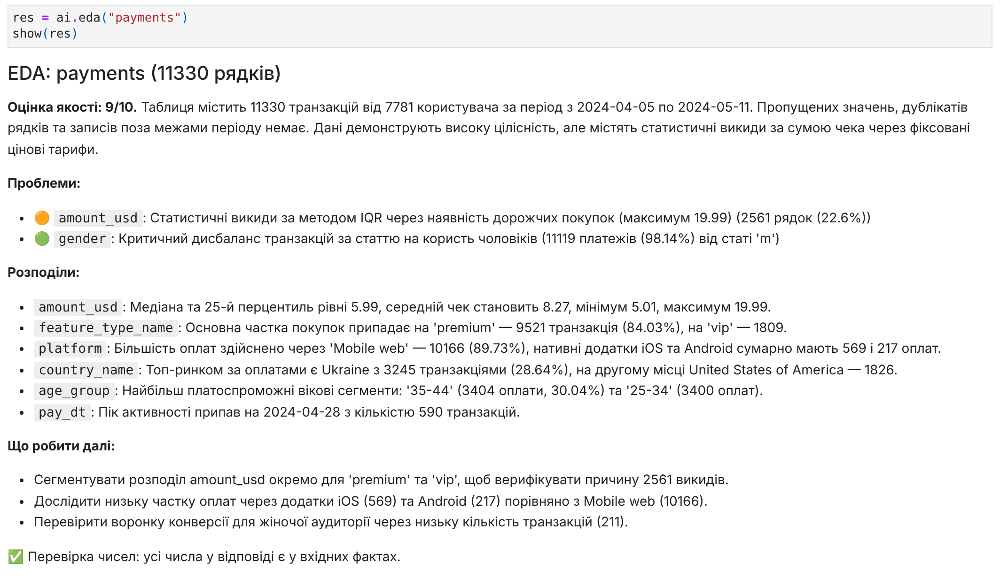
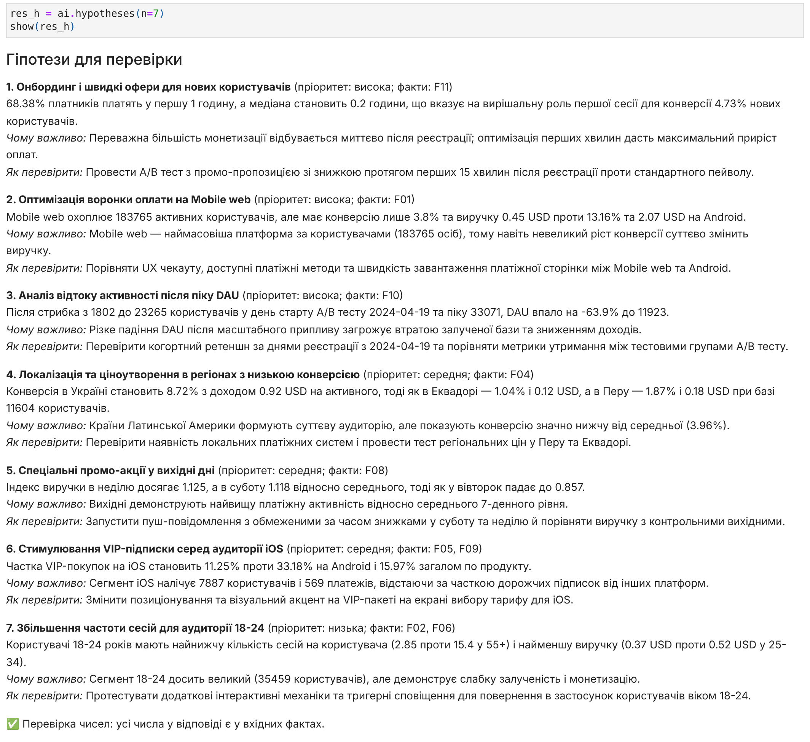
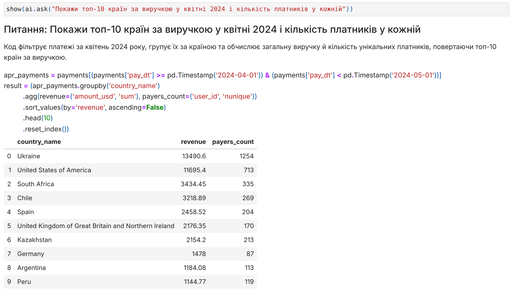
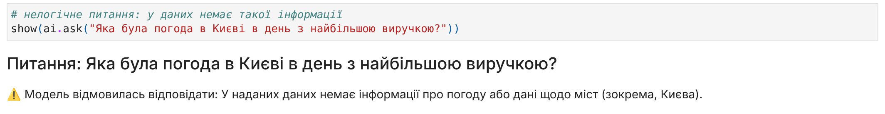
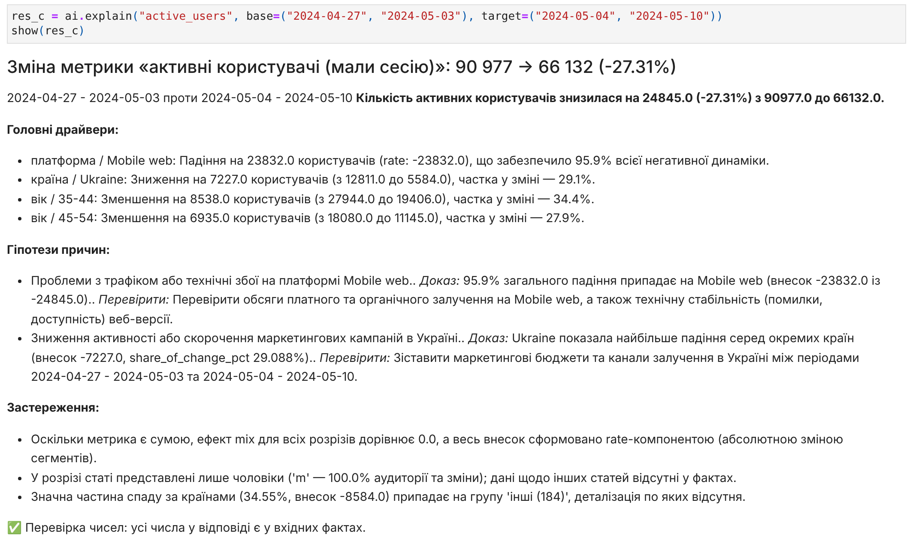
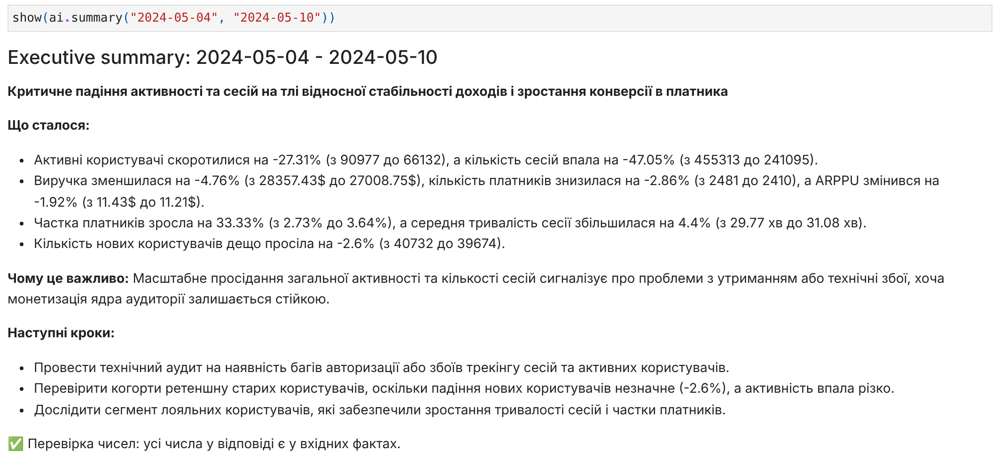

# AI-асистент продуктового аналітика (pandas + Gemini)

Лабораторна робота №4 з дисципліни «Методи та інструменти продуктової аналітики».
Бельдяга Назар, ІП-31.

Це Python-пакет `product_ai` з функціями-помічниками для Jupyter Notebook, які
забирають на себе рутину аналітика: перевірити якість даних, накидати гіпотези,
швидко відповісти на питання до даних, розібратись, чому просіла метрика, і написати
короткий підсумок для менеджера.

Головний принцип: **pandas рахує, LLM пояснює.** Усі числа (профіль даних, розрізи,
внески сегментів, p-value) рахує код. Модель Gemini отримує їх як готові факти у JSON
і пише тільки інтерпретацію. Після кожної відповіді код перевіряє, чи немає в тексті
моделі чисел, яких не було у фактах, і показує попередження, якщо такі є.

## Функції

| Функція | Що робить | Що рахує код, а що модель |
|---|---|---|
| `auto_eda(df)` | Авто-EDA таблиці | pandas: типи, пропуски, дублікати, квартилі, викиди за IQR, дані поза періодом. Gemini: оцінка якості, проблеми з доказами, висновки про розподіли |
| `suggest_hypotheses()` | 5-10 гіпотез для перевірки | pandas: 11 «сигналів» (конверсія за платформою/віком/країною, сесії, дні тижня, DAU...). Gemini: вибирає сигнали і формулює гіпотези з посиланням на них (`fact_ids`) |
| `ask(question)` | Питання природною мовою → pandas | Gemini пише код, код показується, перевіряється через `ast` і виконується в обмеженому середовищі. Якщо падає, модель один раз виправляє |
| `explain_change(metric, base, target)` | Чому змінилась метрика | pandas розкладає зміну за платформою, країною, статтю, віком (для відношень: mix + rate). Gemini: драйвери і гіпотези причин |
| `exec_summary(start, end)` | Підсумок для стейкхолдера | pandas: KPI і зміни проти попереднього періоду. Gemini: заголовок, що сталося, чому важливо, що робити |

Метрики для `explain_change`: `new_users`, `active_users`, `sessions`, `revenue`,
`payers`, `avg_session_min`, `payer_conversion`.

## Датасет

Дані мобільного застосунку знайомств за 5.04-11.05.2024 (ті самі, що в лабораторних 2-3),
лежать у `data/`:

| Таблиця | Рядків | Що в ній |
|---|---|---|
| `registrations.csv` | 202 382 | користувачі: дата реєстрації, стать, вік, платформа, країна |
| `sessions.csv.gz` | 1 507 685 | сесії: початок, тривалість |
| `payments.csv` | 11 330 | платежі: сума, тип (premium / vip) |
| `user_split_groups.csv` | 189 370 | розподіл користувачів у A/B-тесті (дата старту потрібна для гіпотез) |
| `country_info_dict.csv`, `feature_type_dict.csv` | | довідники |

## Запуск

### Google Colab (найпростіше)

1. Відкрий `demo.ipynb` у Colab:
   https://colab.research.google.com/github/nazarbeldyaga/mipa-lab4-product-ai/blob/main/demo.ipynb
2. Створи безкоштовний API-ключ Gemini: https://aistudio.google.com/apikey → **Create API key**.
3. У Colab зліва відкрий **Secrets** (значок ключа), додай секрет `GEMINI_API_KEY`
   зі своїм ключем і увімкни доступ для блокнота.
4. **Runtime → Run all.**

### Локально

```bash
git clone https://github.com/nazarbeldyaga/mipa-lab4-product-ai.git
cd mipa-lab4-product-ai
pip install -r requirements.txt

export GEMINI_API_KEY="твій_ключ"        # Linux / macOS
$env:GEMINI_API_KEY = "твій_ключ"        # Windows PowerShell

jupyter notebook demo.ipynb
```

Модель за замовчуванням `gemini-flash-latest` (безкоштовна Flash), змінюється через
`GEMINI_MODEL`. Приклад у коді:

```python
from product_ai import Analyst, GeminiLLM, load_data, show

ai = Analyst(load_data(), GeminiLLM())
show(ai.eda("payments"))
show(ai.hypotheses(n=7))
show(ai.ask("Покажи топ-10 країн за виручкою у квітні 2024"))
show(ai.explain("active_users", base=("2024-04-27", "2024-05-03"), target=("2024-05-04", "2024-05-10")))
show(ai.summary("2024-05-04", "2024-05-10"))
```

## Демонстрація на реальних даних

Повний прогін з відповідями Gemini збережений у `demo.ipynb` (усі виходи видно прямо на
GitHub), скріни - у `screenshots/`.

Прогін зроблений у Google Colab на моделі `gemini-flash-latest`, 9 запитів до API.
Перевірка чисел у всіх відповідях пройшла без попереджень.

**1. EDA таблиці платежів.** Модель знайшла викиди за сумою (2561 рядок, 22,6%) і
сама пояснила, що це не помилка, а дорожчі тарифи, і порадила розбити суми за
premium / vip.



**2. Гіпотези.** 7 гіпотез, кожна з посиланням на факти. Найцікавіша: 68% платників
платять у першу годину після реєстрації, тобто вирішує перша сесія. Ще модель помітила
стрибок DAU з 1802 до 23265 саме в день старту A/B-тесту (19.04), що схоже на зміну
логування сесій.



**3. Питання природною мовою.** Код видно разом з результатом. На питання про погоду
модель відмовилась, бо таких даних немає.




**4. Чому за тиждень 4-10.05 активних стало на 27% менше.** 95,9% падіння дав Mobile
web, серед країн найбільше впала Україна.



**5. Executive summary** за 4-10.05 проти попереднього тижня.



Що помітив і виправив після прогонів (детальніше в `prompts.md`): код Намібії `NA`
читався як пропуск і дублював рядок при злитті з довідником; модель серйозно писала
про «викиди в user_id», тому ідентифікатори тепер не профілюються як числа; перевірка
чисел не бачила чисел у ключах («35-44»); пропущений вік ставав рядком `"nan"` і не
відфільтровувався через `notna()` (видно в другому питанні демо, виправлено в
`data.py`).

## Технології

Python 3.10+, pandas, numpy, google-genai (Gemini API, structured output через JSON
Schema), tabulate. Модель: Gemini Flash (безкоштовний тариф Google AI Studio).

## Структура

```
product_ai/
  data.py         завантаження і підготовка таблиць, KPI за період
  llm.py          клієнт Gemini (JSON за схемою, повтори при 429/503)
  prompts.py      усі промпти і JSON-схеми
  factcheck.py    пошук чисел у відповіді моделі, яких немає у фактах
  eda.py          1. авто-EDA
  hypotheses.py   2. сигнали і гіпотези
  nl2pandas.py    3. питання → код pandas (перевірка через ast)
  changes.py      4. розклад зміни метрики за сегментами
  summary.py      5. executive summary
  report.py       вивід результатів у Markdown
demo.ipynb        демо на реальних даних
prompts.md        документація промптів
```
